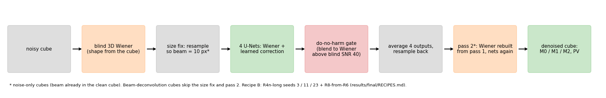
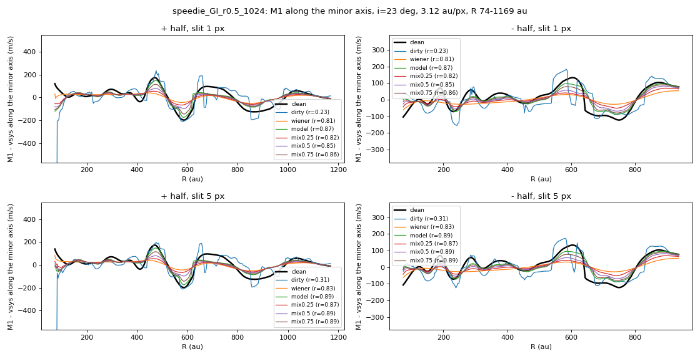

# Denoising Astronomical Observations of Protoplanetary Disks

**Final report: preserving velocity-structure signatures in ALMA line-emission cubes**

*Krishan Yadav, Google Summer of Code 2026, ML4Sci / EXXA*
*Mentors: Jason Terry, PhD · Sergei Gleyzer*
*Draft, 28 October 2026*

## Summary

Line-emission observations of protoplanetary disks carry their most informative signal in a small perturbation of the velocity field: gravitational instability (GI) or an embedded planet displaces the gas by tens of m/s from Keplerian rotation of several km/s. This perturbation, which we call the wiggle, lies close to the noise level, and a denoiser can fail on it in two ways: it can suppress the wiggle together with the noise, or it can generate wiggle-like structure that is not present in the data. Standard image-quality metrics do not separate these cases.

We present a denoiser for line-emission cubes that is evaluated specifically on the wiggle. It combines a classical 3D Wiener filter with a U-Net that learns a correction to the filter output. Evaluation uses simulated disks, 20 real disks from the exoALMA and DSHARP surveys, and Keplerian twin disks (identical to the test disk except that the spiral is absent) to quantify spurious structure. On a disk reserved for a single test, the wiggle score (Pearson correlation of the velocity residual with the noise-free truth) is 0.79 ± 0.06 at peak SNR 24 and 0.59 ± 0.10 at SNR 12, against 0.42 and 0.18 for the Wiener filter alone. The model produces spurious wiggle of about 18 to 27 m/s on twin disks, underestimates amplitudes, and fails on nearly face-on disks. Four attempted improvements, judged against a criterion fixed beforehand, did not pass. Two methodological points are emphasised: the evaluation metric must measure the property of interest, and the test must be specified before results are examined.


*Figure 1. The denoising pipeline, from a noisy cube to a denoised cube and its diagnostic checks.*

## Background

The midterm report described a U-Net that denoised simulated line-emission cubes. A cube is a stack of images, one per velocity channel, so that each pixel holds a spectrum. Collapsing the spectra gives three moment maps: M0, the integrated intensity; M1, the intensity-weighted mean velocity; and M2, the velocity dispersion (line width). The model was evaluated on these maps. Two questions remained open:

1. Does a single model perform consistently across image sizes? The midterm model was trained and tested at 256 px, whereas real cubes vary in size.
2. Does the denoised cube preserve the kinematic signatures that motivate the observations?

## Motivation: the velocity perturbation

In a disk that is gravitationally unstable, spiral arms displace the gas from circular orbits. In the M1 map the result is a small ripple superimposed on the rotation pattern. Embedded planets leave comparable perturbations. Speedie et al. (2024) identified this signature in AB Aur, and Longarini et al. (2024) showed that it can be isolated along the disk's minor axis, the line across the disk perpendicular to the direction of rotation. Along that line the rotational velocity has no component along the line of sight, so the residual velocity is the perturbation. The velocity against position along the minor axis is the position-velocity (PV) curve, and its standard deviation after removal of a smooth trend is the magnitude of the wiggle in m/s.

A denoiser can fail here in two distinct ways. Smoothing removes the perturbation along with the noise, yielding a visually cleaner map with the science content destroyed. Hallucination generates a perturbation absent from the data, which is more damaging because it resembles a detection. Pixel-wise metrics such as the peak signal-to-noise ratio of the reconstruction (PSNR, in dB) and the moment improvements over the noisy cube reward smooth, plausible maps and cannot distinguish the two. The evaluation in this report is therefore built around the wiggle itself.

## Metrics

All scores below lie between 1 (identical to the noise-free truth) and 0 (no relation).

- **Wiggle score** (`rc_r` in the repository). The azimuthally averaged rotation curve is subtracted from the M1 map, and the Pearson correlation between the residual map and the corresponding truth residual is computed.
- **PV r.** The correlation between the PV curve of the denoised cube and that of the truth, measured with a 1 px slice or a 5 px slit after quadratic detrending.
- **PV magnitude.** The standard deviation of the detrended PV curve, in m/s. A correlation measures shape only, so magnitude is always reported with it.
- **Peak SNR.** The peak of the noise-free cube divided by the noise standard deviation. Following the mentors' guidance, results at SNR of about 15 to 20 and above are treated as decisive for real disks, and SNR 6 results are reported for completeness.
- **Twin test.** The same disk with the spiral disabled. Its true minor-axis curve is flat, so the PV magnitude of the denoised twin measures the spurious wiggle introduced by the method.

## Data

Training uses simulated data only. Real ALMA observations are used for evaluation.

- Line-emission cubes from hydrodynamic simulation and radiative transfer, provided by the mentors (as in the midterm).
- Self-gravitating hydrodynamic disks. Disk 9074 is held out entirely.
- Analytic GI disks built from the model of Longarini et al. (2021): six for training, two held out.
- GI simulations of Young et al. (2026), rendered to line cubes with a projector written for this project. Twenty-two serve as test disks, and none was used to train the final model.
- The disk of Speedie et al. (2024) and its Keplerian twin, used for testing only.

Noise is drawn from the measured noise level and channel-to-channel correlation of each cube, at peak SNR between 3 and 150 during training. "Held out" denotes entire simulations that were absent from training and from every tuning decision.

## Method

The network does not denoise from scratch. A blind 3D Wiener filter, a linear filter that weights each spatial frequency by its estimated signal-to-noise ratio and is estimated from the cube itself, provides the baseline. A U-Net, a convolutional network with skip connections that preserve fine detail, learns an additive correction. The output layer is initialised to zero, so the untrained model is exactly the Wiener filter and training can only add to it.

The final model has four components.

- **Ensemble.** Four networks are averaged: three seeds of one long training run, and one fine-tuned with an additional penalty on the line centre (M1).
- **Gate.** Above a blind SNR of 40 the output is blended toward the Wiener result, so that a cube that barely needs denoising is not degraded. On a test cube of SNR about 135 the ungated model worsened M0 and M2 by 76 and 257 percent, whereas the gated model changed them by -4 and +50 percent.
- **Two passes.** The Wiener filter supplied to the network is recomputed from the first-pass output.
- **Size normalisation.** For cubes in which the beam is well resolved, the cube is resampled so that the beam spans about 10 px before inference and resampled back afterwards. The sky field and the angular size of the beam are unchanged.

### Image-size independence

On held-out line-emission cubes the performance of the final model does not depend on image size, whereas that of the midterm model degraded as images grew:

| size (px) | 256 | 300 | 320 | 480 | 600 |
|---|---|---|---|---|---|
| PSNR, final model (dB) | 51.2 | 51.8 | 51.7 | 51.7 | 51.7 |
| PSNR, Wiener (dB) | 30.5 | | | | 30.6 |

M0, M1 and M2 improve over the noisy cube by about 62, 89 and 91 percent at every size.

## Recovery of the velocity perturbation

On the Speedie disk at peak SNR 12 the PV correlation is r = 0.87 for the model, 0.81 for the Wiener filter and 0.23 for the noisy cube. On a held-out analytic disk the values are 0.90 for the model and 0.03 for Wiener. On a Young simulation with a strong wiggle the noisy cube is already competitive with the model (0.73 against 0.80), so the improvement there is relative to Wiener, not to the unprocessed data.


*Figure 2. Minor-axis PV curve for the Speedie disk. Black: noise-free truth.*

### Single held-out test

Model selection used one disk (Speedie, one radius scale). To obtain an unbiased estimate, a second version of the disk (r = 1.5) was reserved and evaluated once, after the model had been frozen:

| Speedie disk, peak SNR | 6 | 12 | 24 |
|---|---|---|---|
| wiggle score: model / Wiener / noisy | 0.06 / 0.05 / 0.00 | **0.44** / 0.17 / 0.03 | **0.70** / 0.41 / 0.16 |
| PV r: model / Wiener / noisy | 0.16 / 0.04 / 0.03 | **0.35** / 0.01 / 0.12 | **0.71** / 0.27 / 0.64 |
| wiggle score, selection disk | 0.14 | 0.60 | 0.83 |


*Figure 3. Minor-axis PV curve on the held-out test disk at peak SNR 24.*

The model outperforms the Wiener filter at SNR 12 and 24 on a disk absent from all tuning. The selection disk scored 0.13 to 0.16 higher in wiggle score while the Wiener result was unchanged between the two disks, which raised the question of selection bias versus an unfavourable noise realisation. Repeating the test with three further noise realisations (the single-run values above are retained as the official result) gives 0.59 ± 0.10 at SNR 12 and 0.79 ± 0.06 at SNR 24, against 0.18 ± 0.03 and 0.42 ± 0.02 for Wiener. The realisation first evaluated was the least favourable of the four.


*Figure 4. Wiggle score against peak SNR. Left: held-out test disk, with the single run as open markers. Middle: selection disk, with the oracle linear filter in black. Right: disk 9074.*

### Spurious structure

On the Speedie twin the true minor-axis curve is flat and the projection alone gives a PV magnitude of 11.4 m/s. Over four noise realisations the model yields 27 ± 5 m/s at SNR 12 and 18 ± 3 m/s at SNR 24. The corresponding values are 33 ± 11 and 14 ± 6 for Wiener and 510 and 113 for the noisy cube. In the two-dimensional residual the model introduces less spurious structure than Wiener (22 against 47 m/s at SNR 12).


*Figure 5. The same measurement on the twin disk. Departures from the flat black line are spurious.*

This defines the detection limit. A PV magnitude below about 25 to 30 m/s at SNR 12 (20 m/s at SNR 24) cannot be distinguished from the model's own artefacts. Wiggles of about 20 m/s or larger are recovered reliably at blind SNR 13 to 18 (four disks, PV r between 0.83 and 0.92). Below about 15 m/s recovery is inconsistent: for 11 Young disks with wiggles of 1 to 14 m/s the median PV r is 0.29, against 0.22 for the noisy cube. At peak SNR 6 and below nothing is recovered.

## What a correlation coefficient does not show

Three properties limit the interpretation of the scores above.

**Amplitude.** A correlation is insensitive to scale. On a fresh analytic disk the model recovers the shape of the wiggle (PV r 0.89, against 0.00 for Wiener) but only 17 of its 57 m/s. On disk 9074 it retains 60 to 70 percent. Recovered amplitudes are therefore lower bounds.

**Ceiling.** The initial target was a wiggle score of 0.85 at SNR 12. An oracle linear filter, constructed from the true spectrum of the disk (information no real observation provides), reaches 0.45 under the same conditions, and the model reaches 0.68. The target lies 0.40 above the linear limit and 0.17 above the model, and was not realistic for these data. The measured curve is reported in its place.

**Floor.** Any recovered wiggle below the level that the twin shows the model can generate (about 15 to 20 m/s) does not by itself constitute evidence of a wiggle.

## Failure cases

**Disk 9074.** This hydrodynamic simulation is held out. At its native SNR of 9.5 the model recovers the wavelength of the wiggle (spine spacing 167 to 178 au against 180 au) but not its pattern, with a wiggle score of 0.45 against 0.31 for the noisy cube, and on the minor axis it is no better than the noisy cube or Wiener. A noise-free reference convolved only with the beam reaches 0.93, so the limit is noise and not resolution. The score increases with SNR (0.57 at SNR 40, 0.70 at SNR 80), and a training disk at the same SNR scores about 0.2 higher, so part of the deficit is a generalisation gap.


*Figure 6. Disk 9074. On the minor axis the model does not improve on the noisy cube.*

**Nearly face-on disks.** Two of the eight fresh Young simulations show no recovery (wiggle score -0.01 and 0.05). Both are nearly face-on, one at 12 degrees. A plausible cause is a line-of-sight component of the perturbation too small to detect at that inclination; this was not tested.

**Compact features.** A planet-like feature of 171 m/s and one beam in width in a Young simulation is recovered by none of the methods tested (the model retains 0.03 of the amplitude). For the real disk HD 142666, where Terry et al. (2023) identified a planet kink, a mirror-asymmetry test of the channel maps, specified before the run, detects nothing above the noise in the raw cube at its SNR of about 7 (0.9 sigma, no larger than in control regions). Whether denoising preserves that kink could not be determined.

## Validation on real ALMA data

No model was trained on exoALMA data. The test set comprises 15 exoALMA disks (13CO) and 5 DSHARP disks (12CO: HD 163296, HD 142666, HD 143006, IM Lup, AS 209), on a 512 px field with the beam resampled to about 10 px. The coarse 0.35 km/s DSHARP channels are interpolated to 0.1 km/s, since at the native channel width the model fails. The released cubes are used without a second continuum subtraction on 19 of the 20 disks. For V4046 Sgr both line-free ends show the same weak point source at the star (about 1 sigma per channel), so it was subtracted; the flux outside 3 beams is 1.02 times that of the raw cube.

Real observations have no truth, so seven checks were designed (`docs/ALMA_CHECKS.md`). The principal ones follow.

**Geometry.** A Keplerian fit to the denoised velocity map recovers the published position angle to within 0 to 3.9 degrees for 19 of 20 disks (exoALMA I; Huang et al. 2018). J1604 is nearly face-on (6 degrees) and cannot be tested.


*Figure 7. Fitted against published position angle for the 20 disks.*

**Rotation curves.** exoALMA VI published rotation curves for all 15 exoALMA disks. The curve derived from the denoised M1 is closer to the published one than that from the raw M1 for 11 of 15 disks (median difference 49 against 64 m/s), and worse for 4, including AA Tau. The residual offset increases with inclination and is the same for raw and denoised data, consistent with the thin-disk assumption of our fit against the elevated emitting surface in theirs.

**Injection and recovery.** The strongest test places a simulated GI disk of known truth in the line-free channels of a real cube, so that the noise and its correlations are real. In MWC 758 the wiggle score is 0.844 ± 0.004 at SNR 12 and 0.926 ± 0.002 at SNR 24 over five noise realisations (Wiener: 0.638 and 0.831), and the line-centre error is 12 to 27 m/s against 26 to 67 m/s for the noisy cube. Across four exoALMA disks the score at SNR 12 ranges from 0.68 to 0.86.


*Figure 8. Injected GI disk in MWC 758 noise at SNR 12. Rows: truth, noisy cube, Wiener, model.*

Recovery is weaker for DSHARP. At SNR 24 the model exceeds Wiener (HD 143006: 0.85 against 0.56). At SNR 12 little is recovered by any method, and on AS 209 the model is worse than Wiener (0.41 against 0.65). On the native channels of AS 209 the score falls to 0.19 at SNR 12, so channel width is the main limitation.

**Real disks.** Without truth only raw and denoised results can be compared. For the bright disk HD 163296 (blind SNR 28) the PV curves agree (r = 0.97). For fainter disks the denoised curve has lower amplitude (IM Lup: 49 against 87 m/s; DM Tau: 6 against 14 m/s), which reflects both noise removal and some loss of real structure. The denoised PV curve is therefore a lower bound on real minor-axis structure. HD 143006 was observed in both surveys, and the agreement of the rotation-curve substructure between them increases from 0.20 (raw) to 0.80 (denoised); this is a single disk without a significance test and is only suggestive.


*Figure 9. HD 163296, minor-axis PV curve, raw and denoised.*

**Flux.** The model does not conserve flux near the star. Beyond 3 beams the denoised flux matches the raw within 0.94 to 1.03 for all 15 exoALMA disks, but within 1 beam it is 1.16 to 1.66 times higher. To establish the source, an analytic disk with a bright compact centre was injected into MWC 758 noise: the model returned 1.30 to 1.39 times the true flux within 1 beam, whereas the noisy cube returned 1.00. The excess therefore originates in the model.


*Figure 10. Line flux divided by true flux in an injection test.*

Rescaling the denoised flux within 2 beams to match the input restores the bright-centre disk to 0.91 to 1.03 and leaves M1 unchanged. It improves M0 on the hydrodynamic simulations (by 8.8 points on average) and degrades it on the smooth analytic disks (by 6.5 points). It is available as an option (`--central-fix`) and is off by default. Flux from the denoised cube should be used only beyond 3 beams.

**Comparison with lower-resolution images.** exoALMA also released 0.3 arcsec images from the same observations. If denoising recovered real structure, smoothing the denoised cube to that resolution should match them better than the raw cube does. It does not (rms difference 1.2 to 1.6 sigma against 0.9 to 1.1 for raw). Because both images share their noise, the test favours the raw cube by construction, and the result is inconclusive to unfavourable.

## Attempted improvements

After the single test the model was frozen. Further attempts were made under rules fixed before any new model was built. A fresh test set was constructed: eight new analytic disks, three no-wiggle twins and eight previously unrendered Young simulations. A candidate would replace the model only if its wiggle score exceeded the three-seed control (0.677) by at least 0.05 on every seed.

On the fresh set the existing model retains a large advantage when the beam has to be undone (wiggle score 0.79 against 0.47 for Wiener, on eight analytic disks that include a four-armed spiral and inclinations outside the training range). When only noise has to be removed, at blind SNR 19 to 34, it ties Wiener on the wiggle (0.80 against 0.78) while remaining 15 to 20 dB better in PSNR. On the eight Young simulations it again exceeds Wiener (0.56 against 0.33; 0.74 against 0.44 excluding the two nearly face-on disks).

Four candidates were evaluated:

- **Central-flux correction.** It cannot improve the wiggle and therefore fails the criterion.
- **More varied training disks.** Twelve additional random analytic GI disks (two to four arms, wider inclination range, half with a bright centre). Neither of two seeds reached the threshold (+0.02 and -0.01 against +0.05).
- **Amplitude-matching loss.** A penalty on the difference between the recovered and true wiggle amplitude. Neither seed reached the threshold (+0.01 and +0.02), and one lost 9 points of line-width accuracy.
- **Hydrodynamic training data.** Three earlier networks trained with 16 Young simulations, none among the test eight, scored 0.53 to 0.54 on the eight, marginally below the control (0.56).

| wiggle score, fresh set | analytic (8) | hydro (8) | all 16 | spurious ripple on twins (m/s) |
|---|---|---|---|---|
| control, 3 seeds | 0.80 | 0.56 | 0.68 | 10.9 |
| more varied disks | 0.84 / 0.80 | 0.56 / 0.52 | 0.70 / 0.66 | 9.4 / 9.4 |
| amplitude loss | 0.82 / 0.83 | 0.54 / 0.56 | 0.68 / 0.70 | 9.5 / 11.8 |
| Young disks in training | 0.85 / 0.83 / 0.79 | 0.53 / 0.54 / 0.54 | 0.69 / 0.68 / 0.67 | 14.3 / 10.4 / 10.5 |
| Wiener filter | 0.78 | 0.33 | 0.56 | |

No candidate satisfied the criterion. Each raised the analytic score slightly and left the hydrodynamic score unchanged, so within this architecture the remaining gap is not attributable to the training data or the loss. It is consistent with the information limit set by the noise, since an ideal linear filter reaches only 0.45 at SNR 12. The model frozen on 18 October is therefore the final model.

Other approaches that did not help: training at lower SNR only (worse recovery); heavier or lighter weights on the line-centre penalty (SNR 12 wiggle score 0.30 and 0.42 against 0.64 as adopted); training at the beam scale (no gain, large seed-to-seed spread); an additional self-gravitating training set; flip averaging at inference; the size normalisation on cubes that require deconvolution; and cropping alone (which loses flux: 1.02, 0.98 and 0.96 at 512, 256 and 128 px). All are documented in `results/PROGRESS.md`.

## Limitations

- No recovery below peak SNR of about 6, or for wiggles below about 15 to 20 m/s.
- Underestimated amplitudes; PV magnitudes are lower bounds.
- No per-pixel uncertainty by default. The 15 to 20 m/s figure is a detection limit, not an error map. The `--boot` option provides an empirical M1 uncertainty map: for MWC 758 the median is 12.6 m/s inside the disk (29 m/s at the 90th percentile, largest near the cavity). It includes the noise term only.
- Spatially uniform noise is assumed. The network receives one noise level per cube and was trained on noise that is constant over the field and across channels, whereas real cubes are noisier toward the edge of the primary beam and near atmospheric lines. Central crops and injection tests limit the effect, but it was not isolated.
- Elliptical beams are treated as circular. Training beams had axis ratios up to 1.3, and real beams up to about 1.35 were processed without visible problems, but the effect was not measured.
- The denoised noise is correlated and non-Gaussian, so fitting tools applied to the denoised cube (eddy, discminer) will underestimate their uncertainties. Uncertainties should be estimated from the raw cube.
- Several real-data results rest on one to four disks.

## Usage and reproducibility

```bash
python experiments/alma_unified.py --cube MyDisc_13CO.fits --out results/alma/mydisc \
    --ckpt unified_r4n_k15_long.pth,unified_r4n_k15_long_s11.pth,unified_r4n_k15_long_s23.pth,unified_r8_m1_r6.pth \
    --crop 512 --target-beam-px 10 \
    --incl 35 --pa 120 --dist 150      # optional: enables the rotation-curve and PV checks
```

For DSHARP-like 0.35 km/s channels add `--spec-interp 0.1`, and for an M1 uncertainty map add `--boot 4`. The script identifies the line-free channels and the noise level from the cube, decides on continuum subtraction, denoises, and returns the cube on its original grid together with moment maps and a `report.json` (noise reduction, flux retained, structure generated in empty channels and, given the geometry, the rotation-curve residual and PV curve). The README states the limits of valid use of the output.

## Conclusions

1. **The metric must measure the property of interest.** PSNR and moment improvements describe a smooth, plausible map and rated the model highly. Only the wiggle score, the twin test and a held-out evaluation showed where recovery succeeds and where it does not.
2. **The test must be fixed before the results are examined.** Reserving disks, setting acceptance thresholds before running candidates, and reporting failures are what make the positive results credible. The first held-out result was the least favourable of four noise realisations, which became apparent only on repeating the test.

Within the limits stated above, the model recovers the wiggle of a gravitationally unstable disk at peak SNR of about 12 and above, with a spurious contribution of about 18 to 27 m/s, and it is accompanied by the diagnostics required to judge that recovery on a given cube.

### Links

- Code and every run archive: https://github.com/KrishanYadav333/EXXA
- Run index: `results/RUNS.md`. Analysis: `results/final/ANALYSIS.md`
- Midterm post: "Denoising Astronomical Observations of Protoplanetary Disks" [link to add]

### References

- Speedie, J. et al. 2024, Nature, "Gravitational instability in a planet-forming disk"
- Longarini, C. et al. 2021, ApJL 920, L41, "Investigating Protoplanetary Disk Cooling through Kinematics: Analytical GI Wiggle" (arXiv:2108.11387), the analytic GI model
- Longarini, C. et al. 2024, A&A 686, L6 (arXiv:2406.05952), minor-axis PV wiggle in Elias 2-27
- Teague, R. et al. 2025, exoALMA I (arXiv:2504.18688); Stadler, J. et al. 2025, exoALMA VI (arXiv:2504.20036), ApJL
- Andrews, S. et al. 2018 and Huang, J. et al. 2018, DSHARP
- Terry, J. P. et al. 2022 (kinematic planet detection); Terry, J. P., Hall, C., Abreu, S., Gleyzer, S. 2023, "Kinematic Evidence of an Embedded Protoplanet in HD 142666 Identified by Machine Learning" (arXiv:2301.05075)
- Czekala, I. et al. 2021 (JvM correction)
