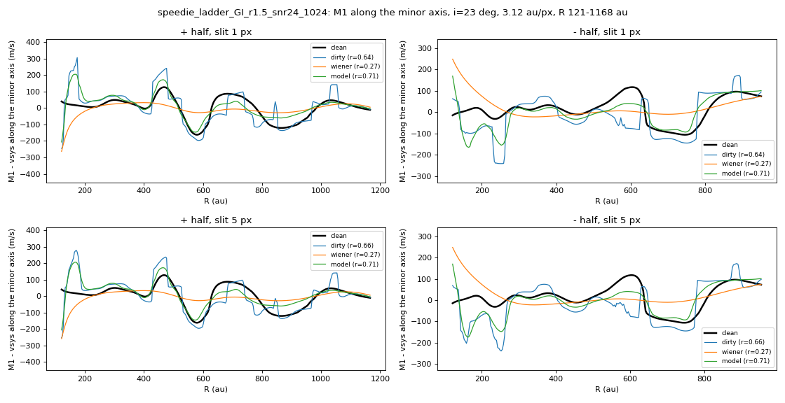
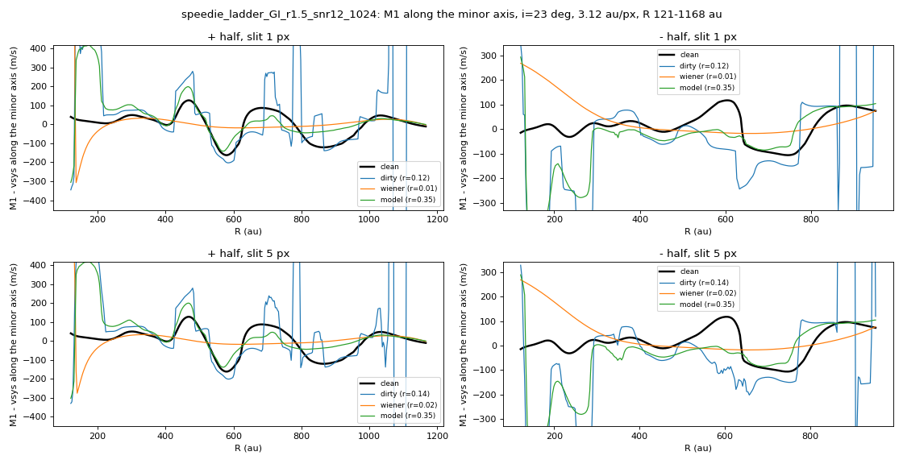
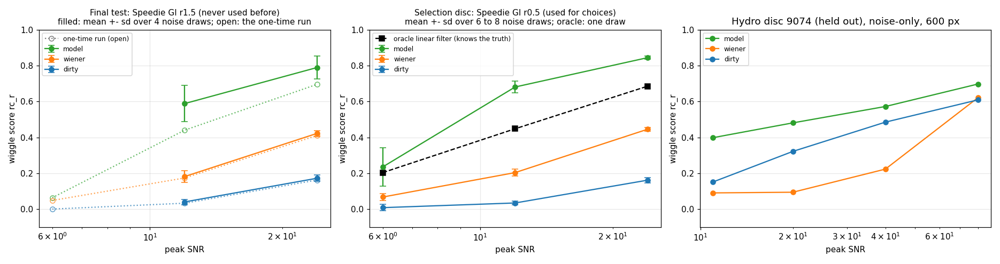

# 01. The one-time final test

The model was selected on one disk: the Speedie et al. (2024) GI disk at one radius scale (r0.5), called the selection disk below. A second version of the same disk (r1.5) was set aside and evaluated **once**, after the model had been frozen.

| Speedie r1.5, peak SNR | 6 | 12 | 24 |
|---|---|---|---|
| wiggle score: model / Wiener / noisy | 0.06 / 0.05 / 0.00 | **0.44** / 0.17 / 0.03 | **0.70** / 0.41 / 0.16 |
| PV r: model / Wiener / noisy | 0.16 / 0.04 / 0.03 | **0.35** / 0.01 / 0.12 | **0.71** / 0.27 / 0.64 |
| wiggle score on the selection disk | 0.14 | 0.60 | 0.83 |

**Noise realisations.** The same test repeated with three more noise draws (the single-run values above remain the reported result) gives a wiggle score of 0.59 ± 0.10 at SNR 12 and 0.79 ± 0.06 at SNR 24, against 0.18 ± 0.03 and 0.42 ± 0.02 for Wiener. The original draw was the least favourable of the four. On the selection disk, repeated draws give 0.24 ± 0.11, 0.68 ± 0.03 and 0.84 ± 0.01 at SNR 6, 12 and 24.

**Linear limit.** An oracle Wiener filter built from the true spectrum of the disk (not available for a real observation) reaches 0.20, 0.45 and 0.68 at SNR 6, 12 and 24 on the selection disk. The model exceeds it by 0.23 at SNR 12 and 0.16 at SNR 24. A target of 0.85 at SNR 12 lies 0.40 above this limit.

## Figures

*Minor-axis PV curve on the final-test disk, SNR 24*

*The same at SNR 12*

*Wiggle score against peak SNR: final test (left), selection disk with the oracle linear filter (middle), disk 9074 (right)*

## Runs in this folder

- [`eval-final-test_v1_2026-10-18/`](eval-final-test_v1_2026-10-18/): the one-time final test (`eval-final-test_v1_2026-10-18/eval_final_test_B.json`); run once, not to be re-run
- [`eval-final-test-seeds_v1_2026-10-21/`](eval-final-test-seeds_v1_2026-10-21/): the same disk with three further noise realisations
- [`eval-ladder-seeds_v1_2026-10-20/`](eval-ladder-seeds_v1_2026-10-20/): the selection disk over several noise realisations
- [`oracle-speedie_v2_2026-10-15/`](oracle-speedie_v2_2026-10-15/): the oracle linear filter on the selection disk (`oracle-speedie_v2_2026-10-15/oracle_speedie.json`)

Where a run folder has its own README, it states the Kaggle run, its settings and its outcome. Kaggle accounts are anonymised.
