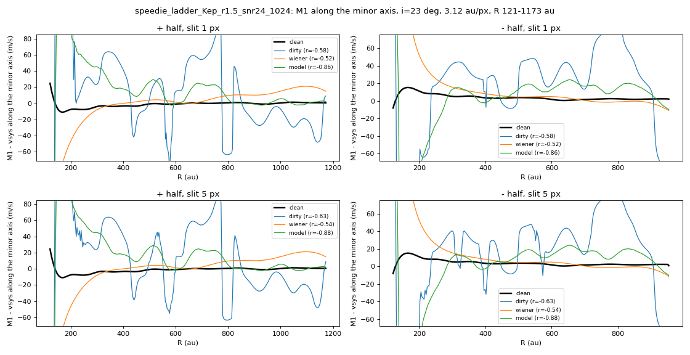
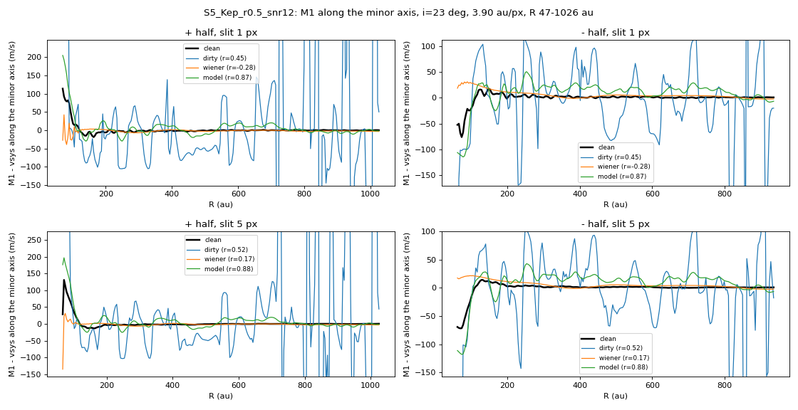
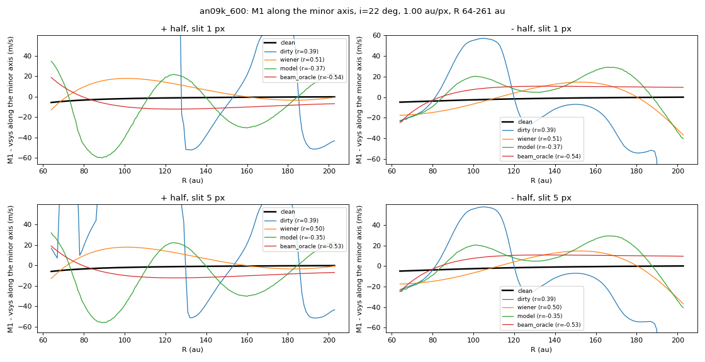

# 02. Spurious wiggle and the detection limit

The Keplerian twin of the Speedie disk is the same disk with the spiral switched off. Its true minor-axis curve is flat (the projection alone gives a PV magnitude of 11.4 m/s), so any wiggle a denoiser draws on it is spurious.

| PV magnitude on the twin (m/s), 4 noise realisations | SNR 12 | SNR 24 |
|---|---|---|
| model | 27 ± 5 | 18 ± 3 |
| Wiener | 33 ± 11 | 14 ± 6 |
| noisy cube | 510 | 113 |

In the 2D velocity residual the model introduces less spurious structure than Wiener (22 against 47 m/s at SNR 12). On the three twins of the fresh test set the model draws 6 to 17 m/s and Wiener 2 to 7 m/s.

**Detection limit.** A PV magnitude below about 25 to 30 m/s at SNR 12 (20 m/s at SNR 24) cannot be distinguished from this. Wiggles of about 20 m/s or more are recovered reliably at blind SNR 13 to 18 (four disks, PV r 0.83 to 0.92); below about 15 m/s recovery is inconsistent (11 Young disks with 1 to 14 m/s: median PV r 0.29 against 0.22 for the noisy cube). Details: `../final/detection_limit.md`.

## Figures

*PV curve on the twin at SNR 24*

*Twin injected into MWC 758 noise, SNR 12*

*Fresh twin an09k: spurious ripple*

## Runs in this folder

- [`eval-ladder-twin_v1_2026-10-21/`](eval-ladder-twin_v1_2026-10-21/): the twin over four noise realisations at SNR 6, 12 and 24 (`eval_ladder_twin_B.json`)

Where a run folder has its own README, it states the Kaggle run, its settings and its outcome. Kaggle accounts are anonymised.
