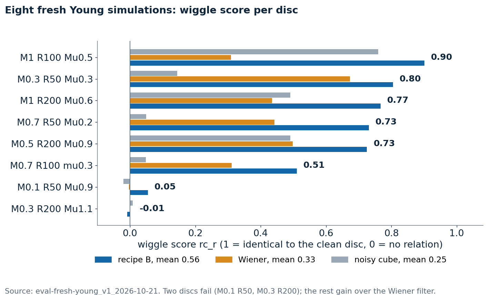
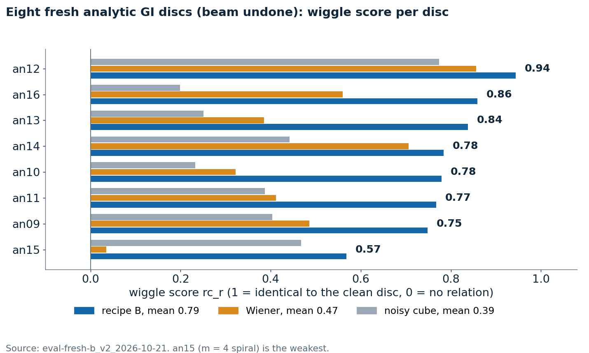
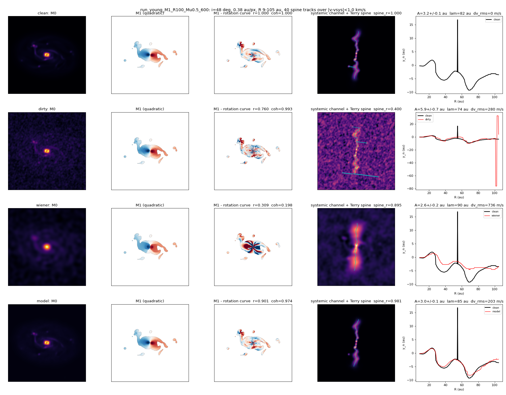
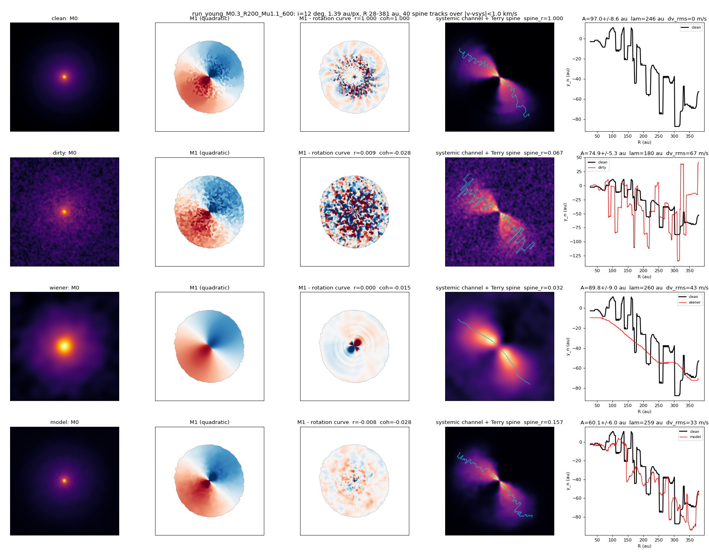
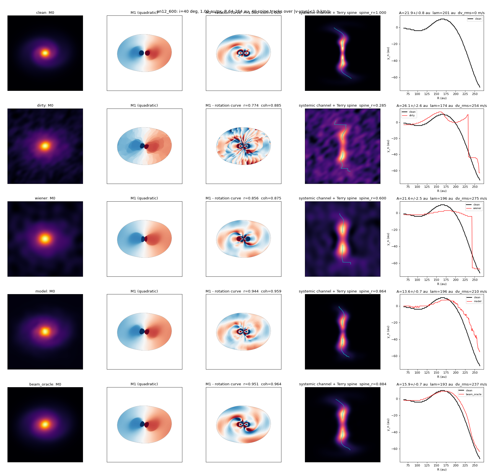
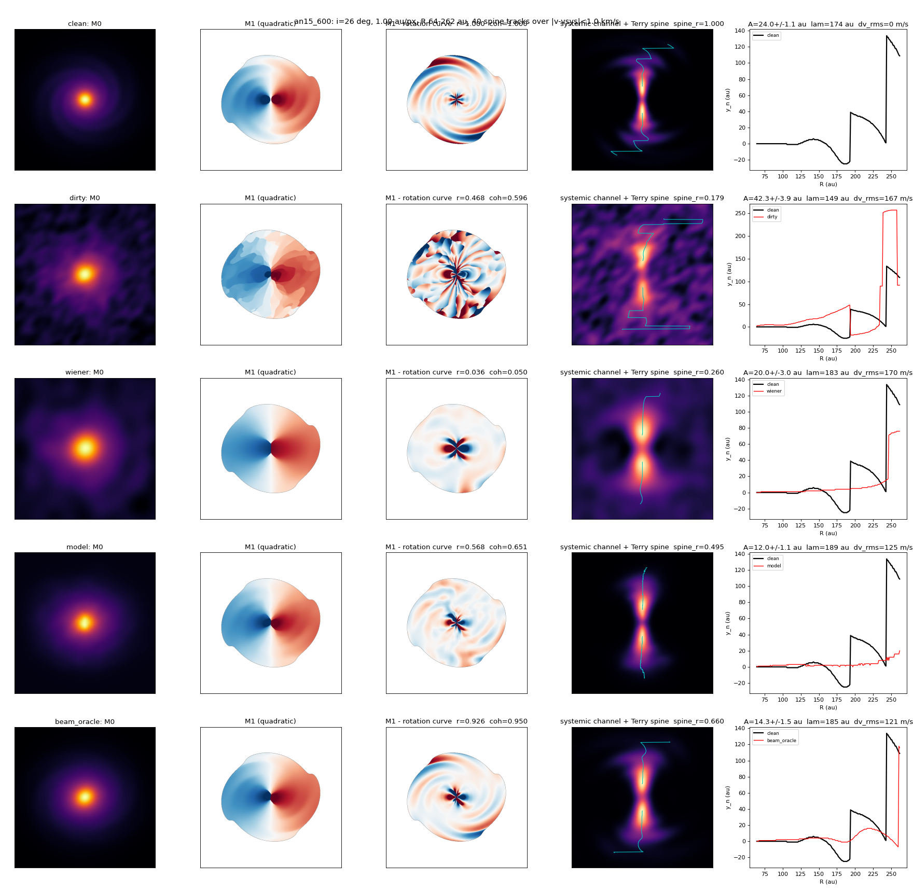

# 03. The fresh test set

After the model was frozen, a fresh test set was built before any result was looked at: eight new analytic GI disks (an09 to an16, including a four-armed spiral and inclinations outside the training range), three no-wiggle twins (an09k, an12k, an15k) and eight Young et al. simulations never rendered before.

| wiggle score | model | Wiener | noisy cube |
|---|---|---|---|
| 8 analytic disks, beam to be undone | 0.79 | 0.47 | 0.40 |
| 8 analytic disks, noise only (blind SNR 19 to 34) | 0.80 | 0.78 | 0.55 |
| 8 Young simulations | 0.56 | 0.33 | 0.25 |
| 6 Young simulations, excluding the two nearly face-on | 0.74 | 0.44 | |

When only noise has to be removed the model ties Wiener on the wiggle while staying 15 to 20 dB better in PSNR. Two Young simulations recover nothing (-0.01 and 0.05); both are nearly face-on. Per-disk tables: `eval-fresh-b_v2_2026-10-21/fresh_tables.md`.

## Figures

*Wiggle score per Young simulation*

*Wiggle score per analytic disk*

*A fresh Young simulation: truth, noisy, Wiener, model*

*A failure: Young M0.3 R200 at 12 degrees*

*Best analytic disk, an12*

*Weakest analytic disk, an15*

## Runs in this folder

- [`eval-fresh-b_v2_2026-10-21/`](eval-fresh-b_v2_2026-10-21/): the analytic disks and twins (`eval-fresh-b_v2_2026-10-21/eval_fresh_B.json` and `fresh_tables.md`)
- [`eval-fresh-young_v1_2026-10-21/`](eval-fresh-young_v1_2026-10-21/): the eight Young simulations (`eval-fresh-young_v1_2026-10-21/eval_fresh_young_B.json`)

Where a run folder has its own README, it states the Kaggle run, its settings and its outcome. Kaggle accounts are anonymised.
