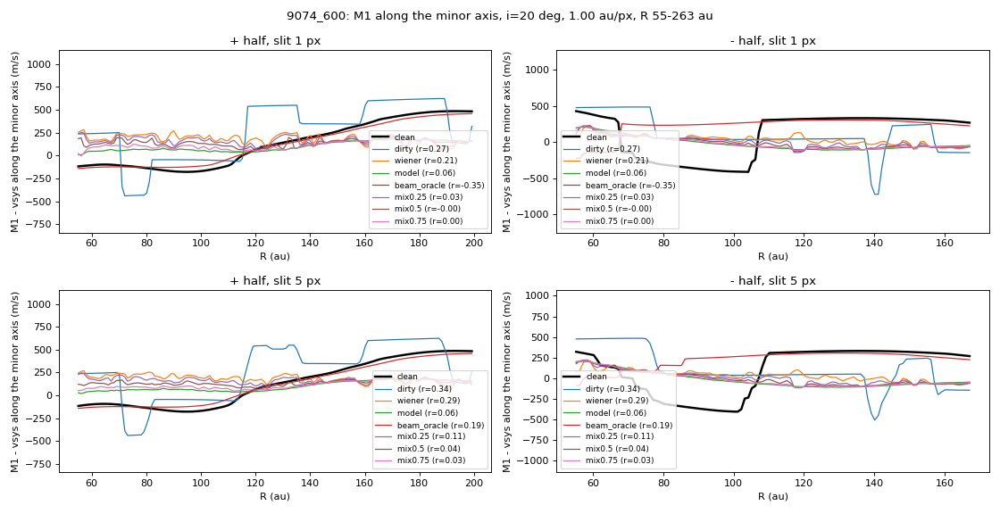

# 04. The hard case: hydrodynamic disk 9074

Disk 9074 is a self-gravitating hydrodynamic simulation held out from training. At its native peak SNR of 9.5 (measured as the peak of the beam-convolved clean cube over the noise rms; the blind estimate in the results file reads about 12) the model recovers the wavelength of the wiggle (spine spacing 165 to 177 au against 182 to 183 au) but not its pattern: wiggle score 0.45 against 0.31 for the noisy cube, and on the minor axis (5 px PV correlation) it is worse than Wiener in the noise-only case (0.27 against 0.77) and not above the noisy cube in the deconvolution case (0.06 to 0.45 against 0.34 to 0.40). A noise-free reference convolved only with the beam reaches 0.93, so the limit is noise, not resolution. The score rises with SNR (0.57 at SNR 40, 0.70 at SNR 80). A training disk at the same SNR on the ladder scores 0.12 to 0.21 higher, so part of the gap is generalisation. The model keeps 57 to 72 percent of the wiggle amplitude (amplitude ratio of the rotation-curve residual, all SNRs and both sizes).

## Figures

*Minor-axis PV curves on disk 9074*

## Runs in this folder

- [`eval-ladder-sg_v1_2026-10-18/`](eval-ladder-sg_v1_2026-10-18/): 9074 and a training disk over an SNR ladder
- [`eval-ladder-sg_v2_2026-10-18/`](eval-ladder-sg_v2_2026-10-18/): the same with the beam-matched PV score
- [`pv-9074-diagnostic_local_2026-10-18/`](pv-9074-diagnostic_local_2026-10-18/): PV detrending diagnostics on 9074

Where a run folder has its own README, it states the Kaggle run, its settings and its outcome.
