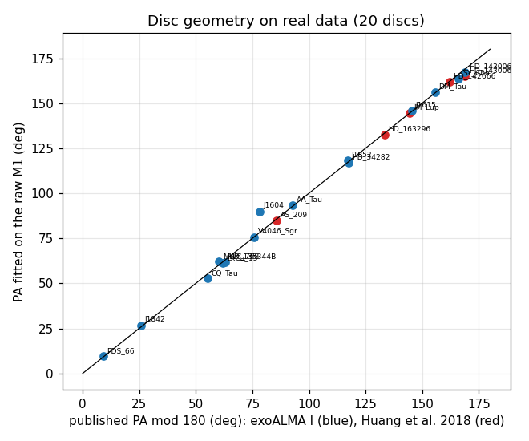
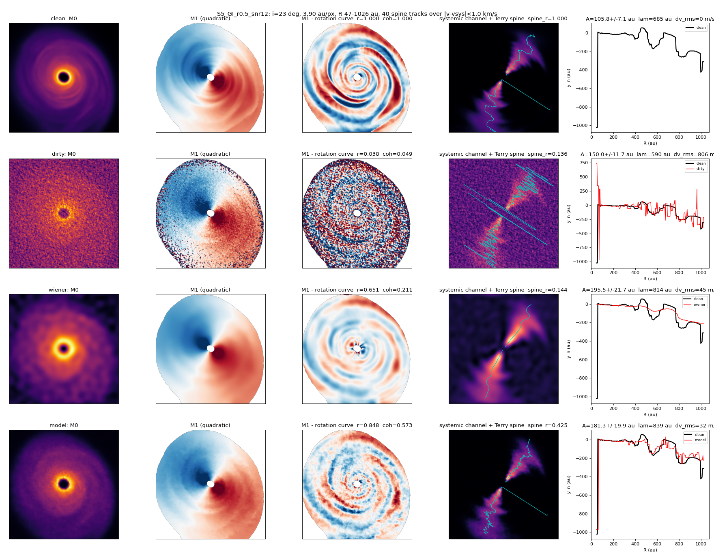
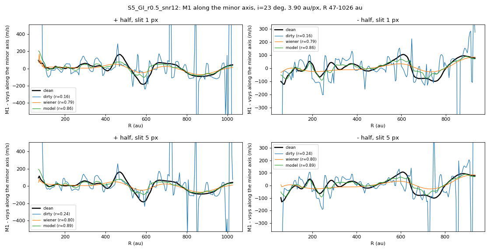
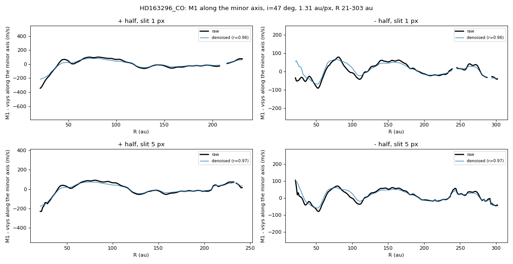
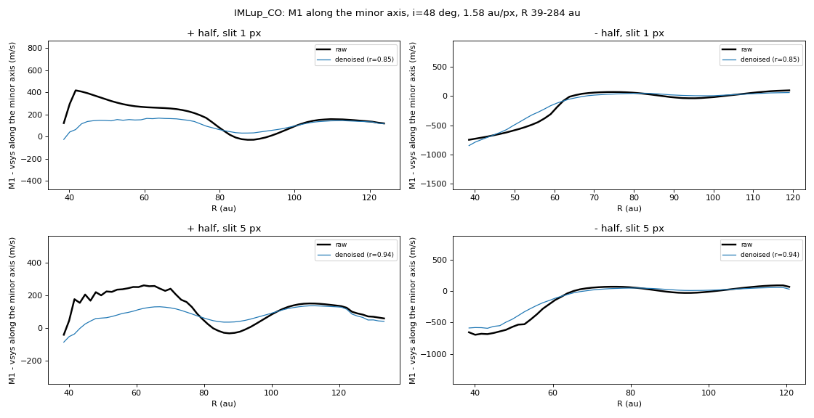
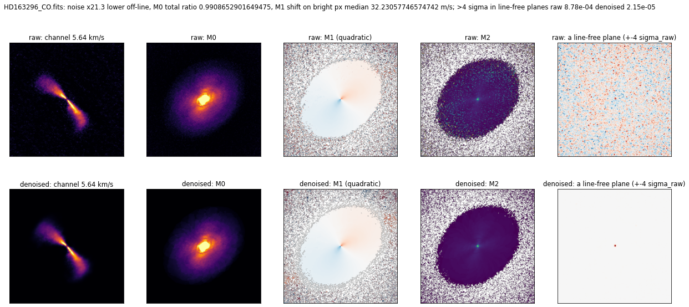
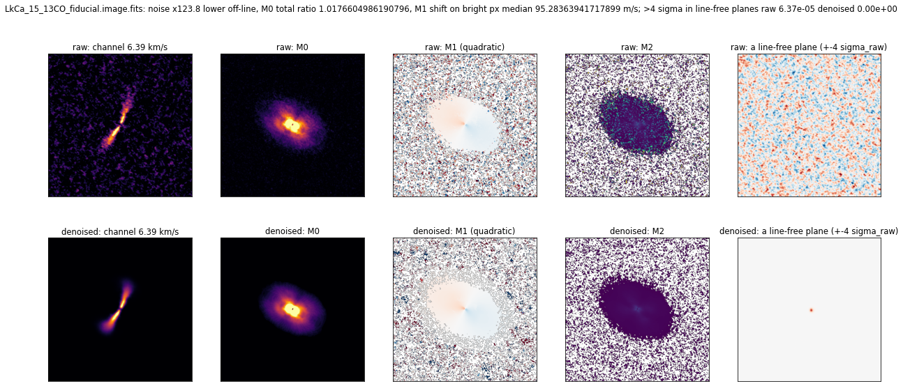
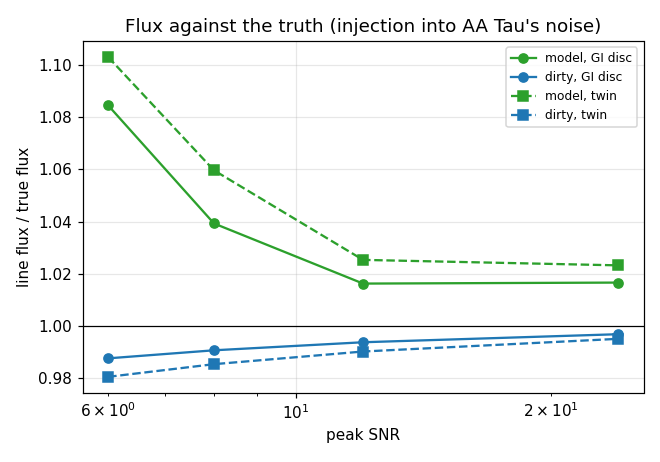

# 05. Real ALMA data: 15 exoALMA and 5 DSHARP disks

Inference only; no model was trained on these observations. Setting: 512 px field, beam resampled to about 10 px, no second continuum subtraction (except V4046 Sgr, see below), DSHARP channels interpolated from 0.35 to 0.1 km/s. The checks S1 to S7 are defined in [`CHECKS.md`](CHECKS.md).

- **Geometry.** The fitted position angle is within 0 to 3.9 degrees of the published value on 19 of 20 disks (the largest is 3.92, HD 143006 in DSHARP); J1604 (6 degrees inclination) cannot be tested. For HD 34282, HD 143006 (exoALMA), PDS 66 and HD 142666 the first fit in the run folders' tables is off by 12 to 69 degrees (a poor start); the figure and this count use the second fit from a different start, kept in each disk's `refit/refit.json`.
- **Rotation curves.** Against exoALMA VI, the curve from the denoised velocity map is closer than the raw one on 11 of 15 disks (median difference 49 against 64 m/s), worse on 3 and equal on 1 (J1604).
- **Injection and recovery.** A simulated GI disk in the line-free channels of MWC 758: wiggle score 0.844 ± 0.004 at SNR 12 and 0.926 ± 0.002 at SNR 24 over five realisations (Wiener 0.638 and 0.831); line-centre error 12 to 27 m/s against 26 to 67 m/s for the noisy cube. Four exoALMA noise fields: 0.68 to 0.86 at SNR 12. DSHARP (from `dsharp-s5fix_v1_2026-10-19/`; the injection in `dsharp-final-p0_v1_2026-10-18/` for HD 143006 was mis-framed, scores -0.2, and is superseded): at SNR 24 HD 143006 0.85 against 0.56 for Wiener; at SNR 12 AS 209 0.41 against 0.65 (the model loses), 0.19 on native channels.
- **Real disks.** HD 163296 (blind SNR 28): raw and denoised PV curves agree (r 0.97). Fainter disks come out flatter (IM Lup 49 against 87 m/s, DM Tau 6 against 14).
- **Flux.** Within 1 beam of the star the denoised flux is 1.16 to 1.66 times the raw (0.94 to 1.03 outside 3 beams). With a bright-centre disk injected into MWC 758 noise the model returns 1.28 to 1.41 times the true flux (SNR 6, 12 and 24, three noise draws each), the noisy cube 1.00. Use flux only beyond 3 beams.
- **Uncertainty.** `--boot 4` on MWC 758: median M1 uncertainty 12.6 m/s inside the disk (29 m/s at the 90th percentile); noise term only.
- **Lower-resolution images (S7).** Smoothing the denoised cube to exoALMA's 0.3 arcsec images does not match them better than the raw cube (rms difference 1.2 to 1.6 sigma against 0.9 to 1.1); inconclusive to unfavourable, since both share their noise.
- **V4046 Sgr.** Both line-free ends show the same weak point source at the star, so continuum was subtracted there (flux outside 3 beams 1.02 times the raw).

## Figures

*Fitted against published position angle, 20 disks*

*Injected GI disk in MWC 758 noise, SNR 12*

*Its minor-axis PV curve*

*HD 163296, raw and denoised PV*

*IM Lup, raw and denoised PV*

*HD 163296 moment maps*

*LkCa 15 moment maps*

*Flux against truth in an injection test*

## Runs in this folder

- [`aatau-s5flux_v1_2026-10-18/`](aatau-s5flux_v1_2026-10-18/)
- [`alma-hd143006-12co_v1_2026-10-19/`](alma-hd143006-12co_v1_2026-10-19/)
- [`alma-kepc-mwc758_v1_2026-10-19/`](alma-kepc-mwc758_v1_2026-10-19/)
- [`alma-s3-recipes_v1_2026-10-18/`](alma-s3-recipes_v1_2026-10-18/)
- [`alma-s4-pixscale_v1_2026-10-18/`](alma-s4-pixscale_v1_2026-10-18/)
- [`alma-s7-lowres_v1_2026-10-19/`](alma-s7-lowres_v1_2026-10-19/)
- [`alma-seeds-mwc758_v1_2026-10-19/`](alma-seeds-mwc758_v1_2026-10-19/)
- [`dsharp-as209-native_v1_2026-10-19/`](dsharp-as209-native_v1_2026-10-19/)
- [`dsharp-final-hd163296_v1_2026-10-18/`](dsharp-final-hd163296_v1_2026-10-18/)
- [`dsharp-final-p0_v1_2026-10-18/`](dsharp-final-p0_v1_2026-10-18/)
- [`dsharp-final-p1_v1_2026-10-18/`](dsharp-final-p1_v1_2026-10-18/)
- [`dsharp-hd142666_spectral-test_v2_2026-10-17/`](dsharp-hd142666_spectral-test_v2_2026-10-17/)
- [`dsharp-hd143006-s5fix-smoke_local_2026-10-18/`](dsharp-hd143006-s5fix-smoke_local_2026-10-18/)
- [`dsharp-s5fix_v1_2026-10-19/`](dsharp-s5fix_v1_2026-10-19/)
- [`exoalma-final-p0_v1_2026-10-18/`](exoalma-final-p0_v1_2026-10-18/)
- [`exoalma-final-p1_v1_2026-10-18/`](exoalma-final-p1_v1_2026-10-18/)
- [`exoalma-final-p2_v1_2026-10-18/`](exoalma-final-p2_v1_2026-10-18/)
- [`exoalma-final-p3_v1_2026-10-18/`](exoalma-final-p3_v1_2026-10-18/)
- [`final-boot-mwc758_v1_2026-10-23/`](final-boot-mwc758_v1_2026-10-23/)
- [`mwc758-13co_base_v1_2026-10-17/`](mwc758-13co_base_v1_2026-10-17/)
- [`mwc758-13co_fov-cs_v1_2026-10-17/`](mwc758-13co_fov-cs_v1_2026-10-17/)
- [`mwc758-13co_fov256_v1_2026-10-17/`](mwc758-13co_fov256_v1_2026-10-17/)
- [`mwc758-13co_fov_v1_2026-10-17/`](mwc758-13co_fov_v1_2026-10-17/)
- [`mwc758-13co_nofov_v1_2026-10-17/`](mwc758-13co_nofov_v1_2026-10-17/)
- [`mwc758-13co_r4n_v1_2026-10-13/`](mwc758-13co_r4n_v1_2026-10-13/)
- [`mwc758-13co_r4n_v2_2026-10-13_crop256/`](mwc758-13co_r4n_v2_2026-10-13_crop256/)
- [`mwc758-13co_recheck_v1_2026-10-16_partial/`](mwc758-13co_recheck_v1_2026-10-16_partial/)
- [`mwc758-13co_s5_v1_2026-10-13/`](mwc758-13co_s5_v1_2026-10-13/)
- [`mwc758-13co_zoom256_v1_2026-10-18/`](mwc758-13co_zoom256_v1_2026-10-18/)
- [`mwc758-13co_zoom512_v2_2026-10-18/`](mwc758-13co_zoom512_v2_2026-10-18/)
- [`s6-published-rotation_2026-10-19/`](s6-published-rotation_2026-10-19/)

Where a run folder has its own README, it states the Kaggle run, its settings and its outcome.
