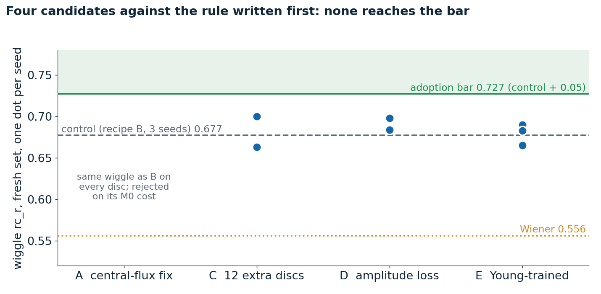

# 06. Improvement attempts, judged by a rule fixed beforehand

After the final test, four changes were tried. The rule was written before any of them was trained: a candidate replaces the model only if its wiggle score on the fresh set (`../03-fresh-set/`) exceeds the three-seed control (0.677) by at least 0.05 on every seed, with PSNR within 0.5 dB, M0 / M1 / M2 within 2 points, and no more than 3 m/s extra spurious wiggle on the twins.

| wiggle score, fresh set | analytic (8) | hydro (8) | all 16 | spurious ripple on twins (m/s) |
|---|---|---|---|---|
| control, 3 seeds | 0.80 | 0.56 | 0.68 | 10.9 |
| C: more varied training disks | 0.84 / 0.80 | 0.56 / 0.52 | 0.70 / 0.66 | 9.4 / 9.4 |
| D: amplitude-matching loss | 0.82 / 0.83 | 0.54 / 0.56 | 0.68 / 0.70 | 9.5 / 11.8 |
| E: Young simulations in training | 0.85 / 0.83 / 0.79 | 0.53 / 0.54 / 0.54 | 0.69 / 0.68 / 0.67 | 14.3 / 10.4 / 10.5 |
| Wiener filter | 0.78 | 0.33 | 0.56 | |

Candidate A, a central-flux correction, cannot change the wiggle and fails the rule on its face; it brings a bright-centre disk from 1.28 to 1.41 times the true flux to 0.91 to 1.03, improves M0 on the hydro simulations by 8.8 points and costs the analytic disks 6.5 points. It is available as `--central-fix`, off by default. No candidate passed.

## Figures

*The candidates against the adoption bar*

## Runs in this folder

- [`eval-fresh-control_v1_2026-10-22/`](eval-fresh-control_v1_2026-10-22/): the control: three seeds of the final training recipe, single networks
- [`unified-cand-c-s71_v1_2026-10-22/`](unified-cand-c-s71_v1_2026-10-22/): candidate C, seed 71
- [`unified-cand-c-s72_v1_2026-10-22/`](unified-cand-c-s72_v1_2026-10-22/): candidate C, seed 72
- [`unified-cand-d-s81_v1_2026-10-22/`](unified-cand-d-s81_v1_2026-10-22/): candidate D, seed 81, first session
- [`unified-cand-d-s81_v2_2026-10-22/`](unified-cand-d-s81_v2_2026-10-22/): candidate D, seed 81, resumed and scored
- [`unified-cand-d-s82_v1_2026-10-22/`](unified-cand-d-s82_v1_2026-10-22/): candidate D, seed 82, first session
- [`unified-cand-d-s82_v2_2026-10-22/`](unified-cand-d-s82_v2_2026-10-22/): candidate D, seed 82, failed session
- [`unified-cand-d-s82_v3_2026-10-22/`](unified-cand-d-s82_v3_2026-10-22/): candidate D, seed 82, resumed and scored
- [`eval-fresh-r5_v1_2026-10-23/`](eval-fresh-r5_v1_2026-10-23/): candidate E, seeds 1 and 2
- [`eval-fresh-r5-s0_v1_2026-10-23/`](eval-fresh-r5-s0_v1_2026-10-23/): candidate E, seed 0
- [`alma-kepc-cfix_v1_2026-10-21/`](alma-kepc-cfix_v1_2026-10-21/): candidate A on the bright-centre injection in MWC 758 noise

Where a run folder has its own README, it states the Kaggle run, its settings and its outcome. Kaggle accounts are anonymised.
