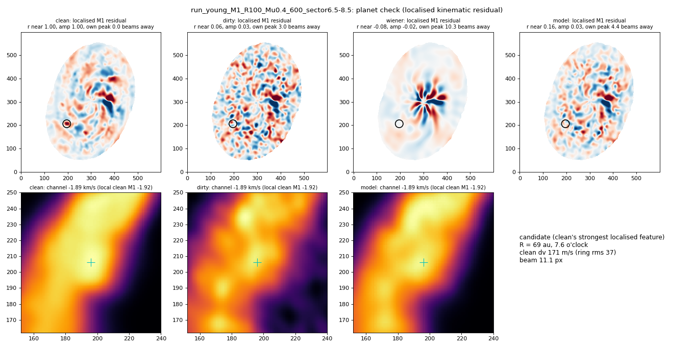

# 08. Compact, planet-like features

A planet-like feature of 171 m/s, one beam wide, placed in a Young simulation is recovered by none of the methods tested (the model keeps 0.03 of its amplitude). On the real disk HD 142666, where Terry et al. (2023) identified a planet kink, a mirror-asymmetry test of the channel maps, fixed before the run, finds nothing above the noise in the raw cube at its SNR of about 7 (0.9 sigma, no larger than in control regions), so whether denoising preserves that kink could not be tested.

## Figures

*Planet-like feature in a Young simulation: truth and every method*

## Runs in this folder

- [`eval-planet_v1_2026-10-18/`](eval-planet_v1_2026-10-18/): the planet-like feature in Young simulations
- [`final-kink-hd142666_v1_2026-10-23/`](final-kink-hd142666_v1_2026-10-23/): the HD 142666 mirror-asymmetry test (`final-kink-hd142666_v1_2026-10-23/kink/kink.json`)

Where a run folder has its own README, it states the Kaggle run, its settings and its outcome. Kaggle accounts are anonymised.
